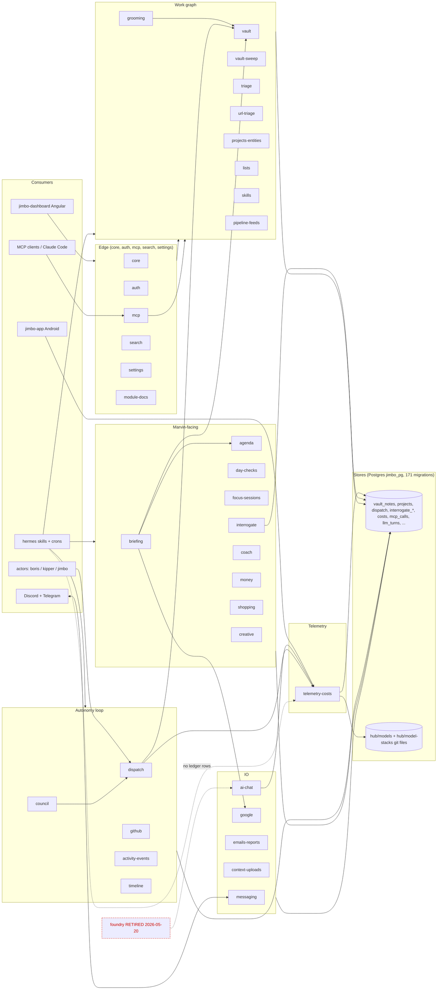

*Report — a research report (2026-10-11), published to cairn by the dispatch flow. Reference material, not a daily reflection.*

## Summary

The note's headline numbers are stale: jimbo-api at HEAD `9437b05` has **117 non-test route files, 239 non-test service files and ~102k non-test lines**, not 64 / 116 / 47.9k [1]. The layering is mostly real, not accumulation: only 4 services have no production importer, and 3 of the 117 route files import no service. The real overengineering signal sits elsewhere. Documentation coverage has not kept up with growth (189 tracked `src/` files are covered by no module doc). The cost ledger is still effectively single-path. A handful of built-but-unwired services are the concrete delete/wire candidates.

Method: derived from the 35 module docs in `jimbo-api/docs/modules/` plus `npm run docs:staleness` [1]. The only thing computed from source is fan-in, by grep of import paths (crude — see Unverified).

## From prior context

The vault note (`Level 2 — map the jimbo ecosystem…`, note_11b885cb) fixes the scope: jimbo-api first, derive from module docs, don't decide the cuts, don't map the 24-repo estate. It also supplies five questions. This doc answers them below. Facts that contradict the note are called out explicitly.

## New findings

### Size and layering (question 1: "116 services behind 64 routes — layering or accumulation?")

| Metric (HEAD 9437b05) | Note said | Measured |
|---|---|---|
| Route files (non-test) | 64 | 117 (102 top-level + `routes/dispatch/`, `routes/interrogate/`) |
| Service files (non-test) | 116 | 239 (216 top-level + `dispatch/`, `scoring/`, `sweep/`, `usage/`) |
| Module docs | 28 | 35, all fresh by `docs:staleness` |
| Non-test lines in `src/` | ~47,900 | ~102,400 |
| DB migrations | — | 171 |
| MCP tool files | — | 11 |

- **Ratio is ~2 services per route file**, which is normal for a thin-route / fat-service design. Only `routes/dispatch.ts`, `routes/dispatch/app.ts` and `routes/interrogate/index.ts` import no service, and these are mount/aggregator files.
- **Fan-in is heavily skewed**: `services/dispatch/shared.ts` (108 importers), `settings.ts` (53), `vault.ts` (50), `note-activity.ts` (28), `dispatch.ts` (26), `paging.ts` (23), `coach-tz.ts` (23). 69 of 239 services (29%) have exactly one importer. That is accumulation-shaped, since single-caller services are one-off logic given a file of its own. It is not dead code.
- **Verdict: layered, not rotting — but 2x the size the note believed.** The risk is the long tail of 69 single-caller services plus the 4 below, not the layering itself.

### Cost ledger shape (question 2: "records only `dispatch_turn`")

Confirmed, with live data. The 7-day `GET /api/costs/summary` returned $239.07 over 4,668 interactions; `by_task_type` had `dispatch_turn` = $239.009 (4,642 rows, 99.98%) and `vault-scoring` = $0.058 (26 rows) and nothing else [2]. Other findings on the same ledger:

- **16 rows are unpriced.** `claude-haiku-5-5` shows `total: null`, `unpriced: 16`, with 1.7M input and 160M cache-read tokens. `pricing.ts` uses hardcoded Anthropic rates [3], so new model ids silently drop out of cost.
- **Claude Code transcripts are counted but not read.** `/api/usage/turns` ingests turns into `llm_turns` and serves totals only; "reading turns for the dashboard belongs to later tasks (JIM-6837)" [3].
- **Hermes/OpenRouter crons** do not write to the ledger (not in `by_task_type`). Hermes has its own `openrouter_spend_pulse` script [4], so spend is watched from the OpenRouter side. Whether it is reconciled with the ledger is unverified.
- Same shape elsewhere: `mcp_calls` is written by one instrumentor and read by a rollup [3]. Device telemetry has one ingest path [3]. `ai-chat` takes a caller-supplied `task_type`, so attribution depends on callers choosing to supply one [5].

### Foundry (question 3: "retired, still in the tree")

- **The tree is clean at the top level**: no `foundry/` directory exists under `fleet/` or `_runtime/jimbo/`. `docs/project.md` still lists it as a manifest entry (`RETIRED 2026-05-20 — autonomy none`) and the README says "kept for reference" [6].
- **Residue that is still there**: `ai-chat.ts` route description and example (`foundry.synthesize`) and `ai-chat.md` ("Known consumers: Foundry") [5]; `messaging.md` ("bot named Foundry on his phone"); `council.ts` comment ("formerly Foundry"); two migrations (`foundry_runs`, `drop_foundry_runs`); `openapi.json`; `docs/reports/foundry-status-2026-07-31.md`; about 30 files in `_runtime/jimbo/docs/` that mention it.
- **Unverified (no VPS access)**: the deployed directory and `/opt/foundry.env` the note mentions.

### Load-bearing defaults (question 4)

- **#3576 is archived and the cause was a gate, not a default.** The 207 jimbo+kipper notes passed the pump's candidate filter and were then thrown away "by the enqueue gate on every single tick" [7]. ADR-0075 records the exclusion of Marvin from grooming as deliberate [8]. This specific case is already resolved. The current grooming funnel shows notes assigned to `boris` flowing to `ready` [2].
- **Defaults that are load-bearing today**, from the module docs:
  - Every grooming question needs a `default_answer`, and `default_applies_at` defaults to now + 7 days when the setting is unset; a pump sweep applies overdue defaults (ADR-0057 decision 4) [9]. Silence now means "the default wins".
  - Decomposition depth cap `max_depth_below_epic` defaults to 2 [9].
  - An unclassified capture from `email`/`webhook` defaults to type `note`; all others default to `task` [10]. The default assignee for an unrouted capture is the `UNROUTED` sentinel [10].
  - `ai-models` runs all tiers through OpenRouter with fallback chains. Three of four tiers were silently dead until `models:validate` existed [3].
- Not found: any equivalent audit listing *all* defaults. Unverified beyond the above.

### Interrogate store (question 5: "7 entity types, 6 empty")

Stale. The module doc now says **8 entity types** [11]. The live snapshot of active rows is: values 4, priorities 1, interests 1, experiments 4, tensions 3, open_questions 25, **goals 0, nogos 0** [2]. So **2 of 8 are empty, not 6 of 7**. The structural point still stands. `services/interrogate-*.ts` is 17 service files for a store whose active content totals about 38 rows. The snapshot excludes archived rows, so "empty" means no active rows.

### Documentation coverage

`docs:staleness` reports **35/35 docs fresh and 189 orphan files**: 153 services, 24 routes, 9 schemas, 3 mcp [1]. Orphan routes include `state`, `steward`, `lanes`, `gates`, `delivery`, `janitor`, `journal`, `rework`, `velocity`, `verify-lock`, `buckets`, `captures`, `checkins`, `commitments`, `fleet-report`. Fresh means "no changes in covered paths", so it says nothing about the ~30% of code that no doc covers. The big autonomy-OS surface (state/steward/lanes/gates/delivery) is the least documented.

## Diagram: routes → services → stores, with consumers

Every module doc is a node. Red = candidate flagged below. Dashed = leftover/retired.

Module-to-area map (all 35 docs): Edge — core, auth, mcp, search, settings, module-docs. Work graph — vault, vault-sweep, grooming, triage, url-triage, projects-entities, lists, skills, pipeline-feeds. Autonomy — dispatch, council, github, activity-events, timeline. Marvin-facing — briefing, agenda, day-checks, focus-sessions, interrogate, coach, money, shopping, creative. IO — messaging, google, emails-reports, context-uploads, ai-chat. Telemetry — telemetry-costs. **Left out of the diagram: the 189 orphan files** (state, steward, lanes, gates, delivery, janitor, journal, rework, velocity, verify-lock, etc.), because no module doc exists to derive them from. Hermes is shown as one node because the jimbo-api module docs only name it as a consumer.

## Candidate list: simplify or delete (for Marvin to decide live)

| # | Candidate | Evidence | Suggested action |
|---|---|---|---|
| 1 | `services/inbox-writers.ts` (268 lines) | No production importer; header says `inbox_decisions` "doesn't exist yet", built in parallel [12] | Confirm JIM-6632 landed; wire it or delete |
| 2 | `services/discord-reply-log.ts` (46 lines) | Only importer is `test/discord-reply-log.test.ts` | Delete with its test, or find the intended caller |
| 3 | `services/code-session-inference.ts` (264) | Only caller is `scripts/infer-code-sessions.ts` | Keep if the script is scheduled; else delete both |
| 4 | `services/reconcile.ts` (161) | Only caller is `scripts/reconcile-emails.ts` (the similarly named `reconcilePrStates` in `state.ts` is unrelated) | Same check as #3 |
| 5 | Cost-ledger blind spots | 99.98% `dispatch_turn`; 16 unpriced `claude-haiku-5-5` rows; no Hermes rows [2][3] | Add pricing for new ids; decide whether Hermes writes via `/api/ai-chat` or stays on OpenRouter-side pulse |
| 6 | Foundry residue | Manifest entry, ai-chat example text and docs, `messaging.md`, `council.ts` comment, ~30 docs files [5][6] | Strip from live code/docs; leave migrations and the dated report |
| 7 | Interrogate surface | 17 `interrogate-*` services; goals and nogos have 0 active rows [2][11] | Don't delete; consider collapsing per-entity services into the generic `interrogate-entity-meta` path |
| 8 | 69 single-importer services | Fan-in grep | Spot-check the largest for inlining; no per-file call here |
| 9 | 189 undocumented files | `docs:staleness` orphans [1] | Either add module docs for state/steward/lanes/gates/delivery, or accept they are undocumented by choice |
| 10 | Stale note numbers | 64/116/47.9k vs 117/239/102k; 6/7 empty vs 2/8 | Update the parent epic text |

## Unverified

- VPS state: the deployed foundry directory and `/opt/foundry.env`.
- Fan-in is a grep of import paths. Dynamic imports (`await import(...)`) and barrel re-exports could hide callers or inflate counts, so check each of #1–#4 before deleting. `reconcile.ts` is imported by a script that is outside `src/`.
- Whether the Hermes OpenRouter spend is reconciled against the ledger.
- Route-level "no consumer" analysis: dashboard and Hermes callers were not enumerated per route, since the module docs do not map routes to consumers. Dead routes remain unmeasured; the `mcp_calls` and request-log data would answer this.
- Number of archived interrogate rows.

## Recommendation

1. **Don't treat this as an overengineering crisis.** The architecture is layered and the docs are fresh. The cost is size (2x what you thought) and an undocumented autonomy core.
2. **Delete or wire #1–#4 first.** They are about 740 lines with no production caller. This is the cheapest cut with the clearest evidence. Check #3 and #4 against the cron/scheduler before removing.
3. **Fix the cost ledger before anything else on telemetry (#5).** Pricing new model ids is a one-line fix and removes the unpriced rows. The structural question, whether Hermes writes to the ledger, is worth discussing live.
4. **Strip Foundry text from live code (#6)** and update the stale note numbers (#10).
5. **Document the orphans (#9) before cutting anything in them.** You can't judge `state`/`steward`/`gates`/`delivery` for deletion without a doc, and they are the largest uncovered surface.

## Sources

1. `jimbo-api` repo at HEAD 9437b05 — `npm run docs:staleness`, `docs/modules/README.md`, file counts from `src/`
2. Live jimbo-api: `GET /api/costs/summary` (7-day window), `GET /api/interrogate/snapshot`, `GET /api/grooming/funnel`, fetched 2026-10-11
3. `jimbo-api/docs/modules/telemetry-costs.md`
4. `_runtime/jimbo/hermes/scripts/openrouter_spend_pulse_test.py`, `hermes/docs/modules/pollers-and-pulses.md`
5. `jimbo-api/src/routes/ai-chat.ts`, `jimbo-api/docs/modules/ai-chat.md`
6. `_runtime/jimbo/docs/project.md`, `_runtime/jimbo/README.md`
7. Vault note #3576 "Trustworthy grooming pipeline" (archived)
8. `_runtime/jimbo/docs/adr/0075-ready-is-one-rule-set-work-is-groomed-before-routing.md`
9. `jimbo-api/docs/modules/grooming.md`
10. `jimbo-api/docs/modules/vault.md`
11. `jimbo-api/docs/modules/interrogate.md`
12. `jimbo-api/src/services/inbox-writers.ts` header comment

